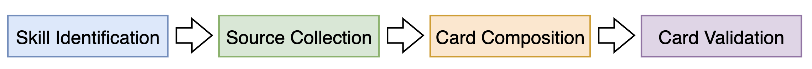

# Agent Skill Cards

Agent Skill Cards is a working group that develops documentation cards for agent skills, so that people and agents can see what is known about a skill before they use it.

This repository holds three things.

- `schema/` holds the Skill Card schema.
- `cards/` holds 30 Skill Cards, each as a JSON file and as a Markdown file. They were generated by a model and were not reviewed by the authors of the skills.
- `src/skillcard/` holds the start of the pipeline that generates the cards.

## The pipeline

The pipeline generates a Skill Card for one skill. It has four phases. Each phase can be built in its own way, as long as it reads and writes the files below. The pipeline for BenchmarkCards is a reference for it: https://github.com/evaleval/auto-benchmarkcard

| Phase | What it does | Reads | Writes |
|---|---|---|---|
| Skill identification | Pins down which skill and which files a card is about. | The skill, as a local folder or as a repository with a path and a commit | `files/` and `snapshot.json` |
| Source collection | Collects what is known about the skill outside its own files. | `snapshot.json` | `sources/` |
| Card composition | Fills in the schema from the files and the collected sources. | `snapshot.json`, `files/` and `sources/` | `card.json` and `evidence.json` |
| Card validation | Checks the card against the files and the sources. | Everything above | `validation.json` |

Every run has its own folder. A phase reads what the phases before it put there and adds its own files.

- `files/` is a copy of the files of the skill.
- `snapshot.json` says where the files came from, lists them and gives their hash. How the hash is computed is described in [schema/guides/which-files-filling-guide.md](schema/guides/which-files-filling-guide.md).
- `sources/` holds what was collected, each item as it was fetched, with a note of where and when.
- `card.json` is the card.
- `evidence.json` says where each value on the card came from.
- `validation.json` says what was checked and what was flagged.

The phases only connect if each of them follows these rules. A phase only adds its own files, it does not change the files of another phase. The validation checks the card but does not change it. And we only read the files of a skill, we never run them.

## License

MIT, see `LICENSE`.
